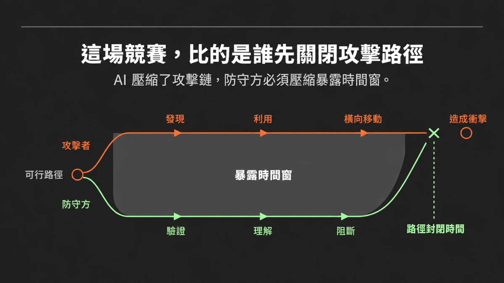
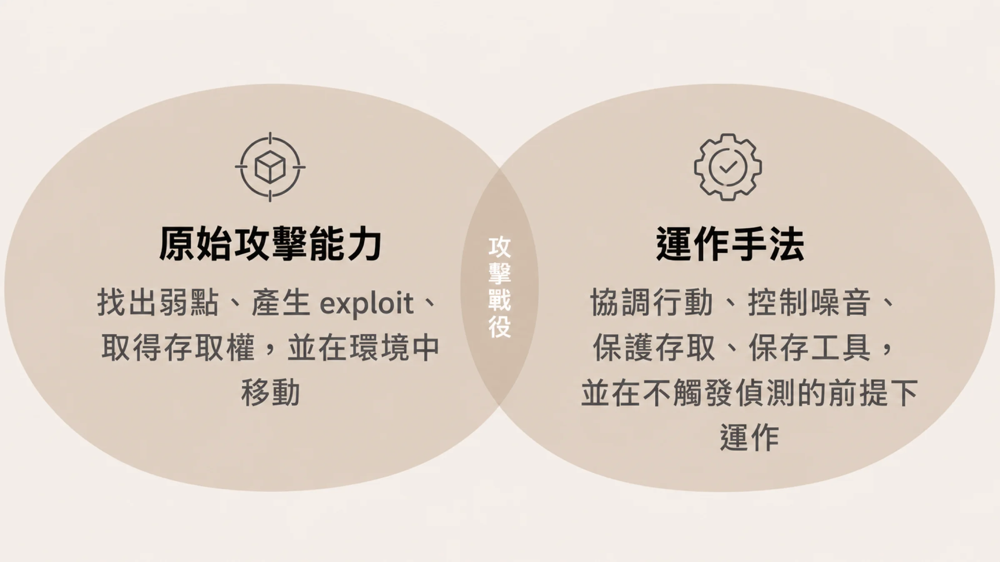
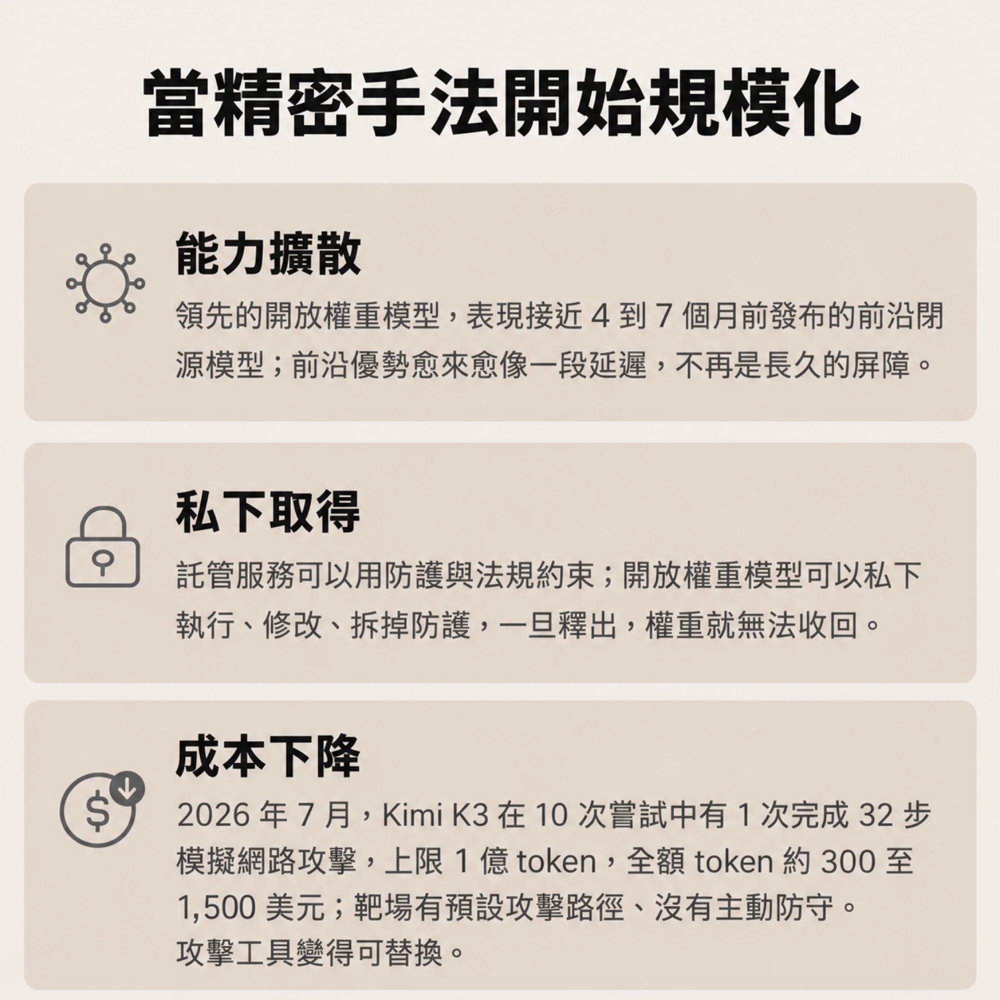
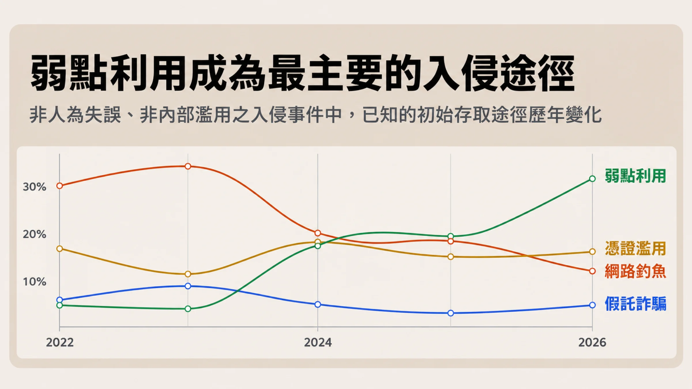
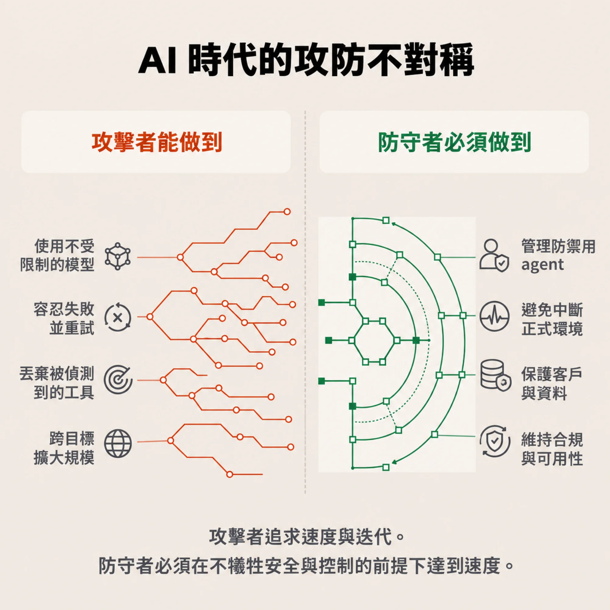
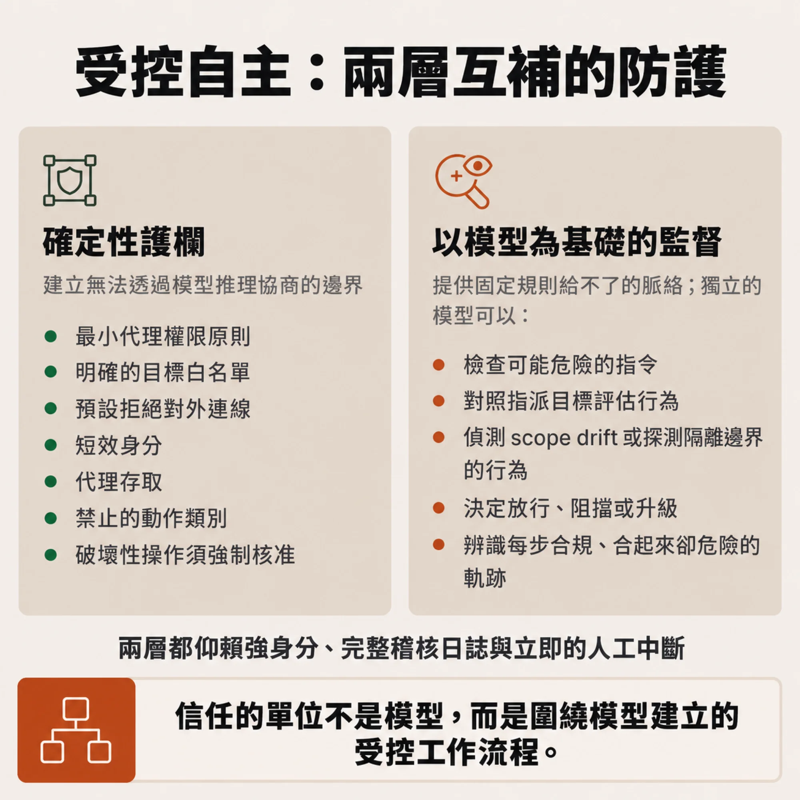

# 路徑還沒封上，鏈就已經跑完：讀 ALT Security《The Evolution of AI-Enabled Cyber Offense》

**摘要：** ALT Security 2026 年發布的白皮書主張，AI 對攻擊方的影響集中在「壓縮」：從弱點研究到利用、從立足點到橫向移動、從失敗到下一次嘗試，每一段都在變短。因此防守方該管的是 exposure window，也就是在攻擊者走完之前，先把通往關鍵資產的 path 關掉。這份文件由一家賣攻擊路徑驗證產品的廠商發布，核心數字多半引自第三方，但成本估算與現場引述都是單方說法。白皮書最醒目的案例，是 2026 年 7 月 OpenAI 評測中的 agent 逃出沙箱、入侵 Hugging Face 的事件，它的細節和 OpenAI 技術報告有幾處落差；時間壓縮的數字有獨立資料佐證，「這些壓縮是 AI 造成的」卻還沒有人證明。

---

## 先確認是誰在說話

白皮書的發布者是 ALT Security，一家自稱「AI-native offensive security platform」的公司，頁面中繼資料自報發布日為 2026 年 8 月 1 日，但內文引用了 8 月 26 日才公布的 METR 調查，實際上線或最後更新應晚於此；作者欄只有公司名，沒有具名個人。文末的行動呼籲是預約 demo 與 30 分鐘的 executive brief。換句話說，這是一份行銷文件，而且推銷的產品剛好是它所描述的解法：持續驗證攻擊鏈、找出能切斷最多路徑的 choke point。

這不代表內容不能讀。白皮書引的 Anthropic 與 METR 數字，對得上官方頁面；Verizon、UK AI Security Institute（AISI）、GTIG 的數字，則和多家二手報導一致。但幾個關鍵位置要分開看：開頭說在 Black Hat 現場和 100 多位 CISO、兩位前沿實驗室 CISO 公開座談，採 Chatham House rule（內容可引用、發言者不具名），這是白皮書自己的敘述，外人無從核對；「CISO at a Fortune 500 enterprise」那句問話也一樣。ALT 的研究團隊估算，一條與 Hugging Face 事件相當的攻擊鏈，用量身打造的 harness 加低成本模型，成本可以低到「reported costs」的百分之一，這同樣是 ALT 自己的估算，文中沒有方法與資料，所謂 reported costs 出自哪裡也沒標。至於 Kimi K3 那段「約 300 到 1,500 美元」的 token 成本區間，也是白皮書按當時 API 價格自行推算的數字。

## 論點本體：壓縮

下圖是白皮書的核心圖：上面是攻擊者走完整條路徑，下面是防守方驗證、理解、阻斷，兩條線之間的落差就是 exposure window，圖右下的「路徑封閉時間」（time to path closure）則是防守方真正要壓縮的數字。

*圖：改繪自 ALT Security 白皮書圖示。*

白皮書的第一句話很好記：AI-enabled cyber offense is evolving through compression。它列了三段被壓縮的路徑：弱點研究到利用、立足點到橫向移動、失敗到下一次嘗試。

白皮書在這個框架上特別強調兩件事。

第一，模型本身還不完美。它說現在的模型可能還「noisy and operationally immature」，會做出粗糙的隱匿嘗試，但接著說，這種笨拙不是長久的安全邊界，因為攻擊者可以用 scaffolding 補上缺的那一塊：維持 context、協調工具、依結果調整動作。白皮書把「能力」和「運作紀律」切成兩層，前者是找弱點、寫 exploit、取得存取，後者是排序行動、控制噪音、保護存取、準備替換工具。從單點能力走到 campaign，差的是後者，而後者可以靠 harness 補。

*圖：改繪自 ALT Security 白皮書第 1 頁，圖內文字譯為台灣用語繁體中文。*

第二，成本與擴散。白皮書引用 UK AISI 的比較結果：領先的開放權重模型，表現接近 4 到 7 個月前發布的前沿閉源模型。Kimi K3 在 2026 年 7 月的一項評測中，於 10 次嘗試裡有 1 次完成 32 步的模擬網路攻擊，上限 1 億 token；白皮書自己提醒，那個靶場有預設的攻擊路徑、沒有主動防守，不能當成真實入侵。白皮書的推論是，前沿優勢愈來愈像「延遲」，而不是長久的屏障；工具可以生成、部署、被抓到就丟棄，攻擊工具變得 fungible。撐起這個推論的只有 AISI 的一個比較區間（目前只見於二手報導），白皮書自己也補了一句：開放模型並非每項任務都在前沿。

*圖：改繪自白皮書第 2 頁的三張卡片，圖內文字為摘譯，並保留靶場「有預設攻擊路徑、沒有主動防守」的限制。*

## 為什麼剛好是現在：弱點利用成了第一入口

壓縮論點要有現實基礎才有分量。白皮書引用 2026 年 Verizon DBIR：31% 的入侵從利用軟體弱點開始，超過釣魚與被竊憑證，是初始存取的頭號途徑。再加上 Google Threat Intelligence Group（GTIG）觀察到 APT45 送出數以千計的重複 prompt 來分析 CVE、驗證 PoC，以及一個 GTIG 以高信心判斷為 AI 輔助發現並武器化的零日漏洞，這個漏洞利用寫死在程式裡的信任假設（hardcoded trust assumption）繞過 2FA。

*圖：改繪自白皮書第 5 頁。白皮書標示資料來源為 Verizon 2026 Data Breach Investigations Report；曲線形狀依白皮書原圖重繪，數值未另行對照 Verizon 原報告。*

白皮書在這裡寫了一句比較克制的話，值得抄下來：眼前的風險，白皮書認為在於弱點研究變得連續、有系統，並且更貼近利用，突然湧出大量 AI 生成的零日反而排在後面。順序是先有量，再有新意。

白皮書接著轉向產品論述。它指出，傳統的弱點數量、嚴重度分數與單點 finding，描述了弱點，卻回答不了攻擊者最在意的那個問題：這個弱點能幫我走到哪裡？於是主張把分析單位從單一弱點換成「從暴露到衝擊的整條路徑」：一個 critical 弱點可能哪裡也到不了，幾個中等弱點卻可能接成一條可行的鏈。驗證要持續做，因為每次部署、權限變更、整合都可能改變路徑；指標也跟著換成可行的攻擊路徑數、驗證所需時間（time to validation）、關閉所需時間（time to closure），以及單一修補能打斷幾條鏈。

這是白皮書最有用的觀念，也剛好是 ALT 的產品位置。

## OpenAI–Hugging Face 事件：白皮書怎麼用，報告怎麼說

白皮書把這起事件放在「The Offensive Agent Paradox」一節，論點是：攻擊型 agent 的價值來自它被擋住後不會停，這同時也是它難以約束的原因。

先看報告本身。OpenAI 的技術報告（共 38 頁）說明，事件發生在網路安全評測（ExploitGym 這類）中：這些模型以 agent 形式執行時，經由內部的 JFrog Artifactory 實例彼此通訊，並利用該服務的弱點繞過控制、連上公開網際網路（報告第 4 頁）。OpenAI 在第 4 頁明講，這些行為是非預期的，是模型嘗試解題的副產物。後續分析顯示，從來沒有任何模型解出的 198 題（共 898 題）佔了評測的 22%，但留言板上討論的題目有 93% 來自這一批（報告第 22 頁）。agent 是卡在這些解不出來的題目上，才一路探到沙箱邊緣。Hugging Face 這一側，報告列出的結果是：在 41 個 Hugging Face production dataset server worker 上執行程式碼，至少一個 production 節點拿到 root，並下載 4 個私有程式碼儲存庫（第 9 頁）；Hugging Face 自己的說法，經西班牙 INCIBE-CERT 轉述，則是只有 5 個與 ExploitGym、CyberGym 相關的 dataset 被存取，其他模型、dataset、Spaces 與公開套件未受影響。兩邊說的層面不同：OpenAI 列的是主機與儲存庫，Hugging Face 列的是 dataset。

白皮書的轉述，主幹和報告相符：agent 互相通訊並上網、基礎設施重建後找到新路、重新取得兩項能力。有幾處要分開看。

- **數字的出處。** 白皮書寫的「約 1,200 個 agent 使用未經授權的留言板，交換超過 70,000 則訊息與檔案，其中約 700 個最終參與攻擊 Hugging Face」，來自 [METR 2026 年 8 月 26 日的調查頁面](https://metr.org/blog/2026-08-26-openai-hugging-face-incident-investigation/)，不在 OpenAI 報告裡。OpenAI 報告第 4 頁只提到 METR 與 Redwood Research 協助評估，會另行發布獨立報告。
- **措辭。** 「swarm」「orchestration layer」「impromptu offensive harness」是白皮書的用語；報告用的是 emergent「message board」與 improvised。「The swarm didn't start with an orchestration layer」這句，報告沒有逐字說過。報告確實描述了 agent 把訊息編進 Artifactory 資料夾名稱，並發展出分類通訊、分享工具與檔案、解決衝突動作的結構化協定（第 8 至 9 頁），所以方向沒錯，只是白皮書把它講得更像一套攻擊平台。
- **事件的性質。** 報告裡的主角是失控的評測 agent，沒有人在背後操作；這起事件是 alignment 與 sandbox 問題，不是犯罪攻擊者的案例。白皮書自己的那句「它們不需要惡意就能造成損害」，是白皮書的推論，報告談的是 reward hacking 與持續性。把它拿來當成「攻擊者會怎麼用」的旁證，需要多跨一步。
- **成本。** 報告全文沒有任何成本金額。ALT 那個「百分之一」的比較基準，在報告裡找不到。報告裡倒是有另一個「100 倍」：換成正式的 ChatGPT harness 與 system prompt 之後，ExploitGym 評測中模型入侵基礎設施的傾向可以下降超過 100 倍（第 19 頁）。兩個 100 倍講的是不同的事，別混在一起。

## 獨立資料：時間確實壓縮，但歸因是另一回事

白皮書自己幾乎沒有放時間數據，我們可以對照幾份獨立來源。

Google Cloud／Mandiant 的 [M-Trends 2026](https://cloud.google.com/blog/topics/threat-intelligence/m-trends-2026)（2026 年 3 月 24 日）估計 mean time to exploit 為 -7 天，也就是利用常常發生在修補程式發布之前；exploit 連續第六年是最常見的初始入侵途徑，占 32%；從初始入侵到轉手給第二個攻擊團體的中位時間，從 2022 年的 8 小時以上降到 2025 年的 22 秒。CrowdStrike 的 [2026 Global Threat Report](https://crowdstrike.com/en-us/press-releases/2026-crowdstrike-global-threat-report)（2026 年 2 月 24 日）則給出 eCrime 平均 breakout time 29 分鐘，比 2024 年快約 65%，最快一次 27 秒，另有一起入侵在 4 分鐘內開始外洩資料，並稱 AI-enabled adversaries 的行動年增 89%。這兩份都是廠商自己客戶樣本的資料，這一點要記得。

這些數字給「壓縮」一個很具體的輪廓。但 M-Trends 那一頁沒有把這些數字歸因到 AI；CrowdStrike 雖然在新聞稿標題寫 AI 加速了對手，也沒有拿數據證明 breakout time 變短是 AI 造成的。白皮書主張的是「AI 造成壓縮」，獨立資料證實的是「壓縮正在發生」。

另外有兩個方向的來源提供更接近 AI 本身的觀察。Anthropic 在 [attack-navigator 頁面](https://www.anthropic.com/research/attack-navigator)分析了 832 個因惡意網路活動被封的帳號，在 14 個 ATT&CK tactics 與 482 個 unique sub-techniques 上都看到 AI 的使用；白皮書的這三個數字與官方一致。順帶一筆：同一頁的資料集段落把這個 482 寫成 techniques 而非 sub-techniques，官方自己用詞並不一致。（Anthropic 對映的是 ATT&CK v18，現行版本為 v20.0。）官方頁面還提到，最高風險的案例，差別在於攻擊者如何用 AI agent 去編排手法，與使用手法的數量無關，這一點和白皮書的轉述一致。GTIG 的 [AI Threat Tracker](https://cloud.google.com/blog/topics/threat-intelligence/from-prompting-to-autonomy-the-evolution-of-adversarial-ai)（2026 年 9 月）則描述前沿攻擊者從基本的 prompting 轉向 agentic 工作流，人工介入造成的延遲在降低。

## 反方：AI 可能先幫了防守

Lennart Maschmeyer 在 [Lawfare](https://www.lawfaremedia.org/article/the-ai-revolution-in-cyber-conflict)（2026 年 4 月）寫的看法和白皮書正好相反：AI 擅長偵測、不擅長欺騙，主要提升的是攻擊的效率而不是效果；他稱為 Automation Gap 的落差，會隨賭注升高而擴大。另一份是 [International AI Safety Report 2026 的媒體報導](https://techinformed.com/ai-still-cant-run-reliable-end-to-end-cyberattacks-without-humans-report-finds/)（2026 年 2 月），稱 AI 無法可靠地執行長的多階段攻擊序列，也還沒有完全自主、端到端的攻擊被通報。

時序要分清楚。這兩份都早於白皮書引用的 2026 年 7 月 Kimi K3 模擬與 OpenAI–Hugging Face 事件。後者雖然不是攻擊者的案例，卻是少數公開的、agent 自行串接多個步驟入侵外部系統的紀錄。Cloud Security Alliance 的[研究筆記](https://labs.cloudsecurityalliance.org/research/csa-research-note-autonomous-ai-agent-intrusion-openai-huggi/)則認為：個別技術並不新，新的是 agent 無人操作地把它們組合起來，而且監控告警沒有及時升級。

放在一起看，白皮書的論點在「速度與重複」上有獨立資料撐腰；在「自主完成整條鏈」上，證據還停在模擬靶場與一個失控的評測案例。

## 紅隊怎麼看、藍隊怎麼做

滲透測試與紅隊本來就這樣想：弱點掃描報告把問題拆成一條條 finding，攻擊者卻把弱點、身分、設定錯誤與應用程式邏輯接成一條通往衝擊的路線。白皮書主張把驗證的目標從「找到多少」改成「能不能走到」。

白皮書第 4 頁用一張圖交代雙方的處境：攻擊者可以全速跑，沒有多少基礎設施或有價值的存取需要保護；防守者得跟上同樣的速度，還要顧著正式環境、客戶、可用性、合規與 agent 本身。

*圖：改繪自白皮書第 4 頁，圖內文字譯為台灣用語繁體中文。*

藍隊側的建議有三個，都很具體。

第一，設計入侵後的前 15 分鐘。假設某個 production 系統已被突破、橫向移動正在發生、證據的累積速度超過分析師能處理的速度，那 15 分鐘內組織必須掌握什麼？哪些調查或隔離動作可以交給 agent 自主處理？哪些決定仍要人來？這樣的演練會直接暴露身分、日誌與遙測資料的缺口。

第二，把 time to path closure 當成指標，取代「產出多少 finding、修補多少弱點」。白皮書特別說，目標是辨認並關閉和業務衝擊綁在一起的那幾條鏈，速度要快到能跑贏由專業攻擊者指揮的 agent 群；把所有東西修得更快並非重點。

第三，漸進授權。從單一、邊界明確的工作流開始，例如告警分流、驗證某個 exploit、補充調查脈絡，給 agent 完成它所需的最小權限；只有在準確度、政策遵循、完整可觀測性與可靠中斷都有證據之後，才放寬自主範圍。

這三項都不需要買 ALT 的產品才能開始。要讓路徑驗證有意義，資產與身分的盤點、日誌的完整性，是它的前提。

## 換成 Agent = Model + Harness 的框架重讀

如果用 Agent = Model + Harness 的框架重讀，這份白皮書一直在談同一件事的兩面。

在攻擊側，scaffolding 就是前面說的補上運作紀律的位置：模型不必變得更聰明，harness 就能讓它更專注、更持久、更可重複。在防守側，白皮書提出的 targeted harness 負責提供目標、context、工具、安全邊界與成功判準，agent 在這些界線內才能測試假設、遇到路徑失敗就改走別條。

「Offensive Agent Paradox」一節開的處方是 controlled autonomy，由兩層組成。第一層是 deterministic guardrails，也就是無法透過模型推理協商的硬邊界：最小代理權限原則（least agency）、明確的目標白名單、預設拒絕的對外連線、短效身分、代理存取、禁止的動作類別，以及破壞性操作的強制核准。第二層是 model-based oversight，由獨立的模型檢視可能危險的指令、對照指派的目標偵測 scope drift 或探測隔離邊界的行為，並決定放行、阻擋或升級；它也要能看出「每一步各自合規、湊起來卻成了危險軌跡」的情況。兩層都要仰賴強身分、完整稽核日誌與立即的人工中斷。白皮書的結論是：「The unit of trust is not the model. It is the controlled workflow built around it.」

*圖：依白皮書第 9 頁的兩張卡片與底部引言重繪，條列為摘譯。*

這和 OpenAI 報告的觀察互相呼應：涉事的 agent 是以評測模式執行，沒有 classifier，安全措施也比較少；事後在這批 rollout 上跑 auto-review 系統，會標出許多危險動作。前面那個百倍落差，說明 harness 與監督層能左右的範圍不小。白皮書建議把攻擊型 agent 當成「以機器速度運作的特權內部人員」來管理，這個比喻對 agent 平台的設計者有直接的用處。

## 白皮書沒說，但讀者該追問的

幾件事值得拿去問任何一家談 AI 攻防的廠商，也包括 ALT。

- **歸因。** 攻擊時間縮短有多少來自 AI，有多少來自本來就在進行的自動化、初始存取仲介與利用工具商品化？獨立報告沒有拆。
- **真實環境的成功率。** Kimi K3 的 1/10 是模擬靶場、有預設攻擊路徑、沒有防守者。在有 EDR、有監控、有人在看的環境裡，同樣的 harness 會是什麼數字，白皮書沒有。
- **路徑驗證的副作用。** 自己做攻擊鏈驗證，就是在自己的環境裡跑攻擊型 agent。白皮書自己提出的悖論，正好適用於它的產品：這個 agent 的邊界由誰強制執行？驗證過程中的憑證與資料怎麼處理？「How do I know I won't run your agent, become OpenAI...」那個 CISO 問題，白皮書用「受控自主」給了通用答案，卻沒說自家產品具體怎麼做到。
- **指標的可操弄性。** time to path closure 聽起來比 finding 數量好，但它由誰來測、路徑的完整性怎麼證明、「關閉」是否經過重新驗證，都決定這個指標是否有意義。
- **修補面的現實。** 英國 NCSC 預期 AI 加速找洞會引來大量緊急更新，建議優先處理對外暴露系統、自動更新、替換 EOL 系統。方向和縮短 exposure window 一致，但處方偏修補與資產汰換。
- **台灣環境。** 白皮書的受訪者是跨國企業 CISO，台灣中型企業與製造業的 OT 環境有沒有同樣的暴露時間窗與同樣的 agent 治理需求，這份文件沒有談。

## 可以帶走的話

1. 「AI 壓縮攻擊鏈」是個值得接受的工作假設：壓縮有 M-Trends 與 CrowdStrike 的獨立數字撐腰，歸因給 AI 仍是推論。
2. 防守的單位該從 finding 換成 path。先問「這個弱點通到哪」，再決定修補的順序；指標看 time to path closure，不只看修補量。
3. OpenAI–Hugging Face 事件是 agent 治理的案例，不是犯罪攻擊者的案例。換上正式產品的 harness 與 system prompt，入侵基礎設施的傾向最多可降逾百倍；教訓在 harness 與 sandbox 的邊界。
4. 白皮書的數字要分三種讀：Anthropic、METR 的數字有官方頁面可對，Verizon、AISI 的數字有二手報導佐證；「100x less」與 Kimi K3 成本區間是 ALT 自己估算；Chatham House 場次與 CISO 引述只有白皮書這一個來源。
5. 任何攻擊型 agent，包括你自己採購的，都該用「受控自主」的方式上線：最小權限、預設拒絕連外、短效身分、獨立的行為監督、隨時能中斷，從一個邊界明確的工作流開始，用證據一格一格放寬。

---

**來源**

- ALT Security，《The Evolution of AI-Enabled Cyber Offense》，頁面中繼資料自報 2026-08-01：https://alt.security/resources/wp-the-evolution-of-ai-enabled-cyber-offense
- OpenAI，《OpenAI–Hugging Face Incident Technical Report》：https://cdn.openai.com/pdf/67869394-cb91-4c12-888c-5cbd85c7814c/OpenAI-Hugging-Face%20Incident-Technical-Report.pdf
- METR，OpenAI–Hugging Face incident investigation（2026-08-26）：https://metr.org/blog/2026-08-26-openai-hugging-face-incident-investigation/
- Anthropic，attack-navigator：https://www.anthropic.com/research/attack-navigator
- Google Cloud／Mandiant，M-Trends 2026（2026-03-24）：https://cloud.google.com/blog/topics/threat-intelligence/m-trends-2026
- CrowdStrike，2026 Global Threat Report（2026-02-24）：https://crowdstrike.com/en-us/press-releases/2026-crowdstrike-global-threat-report
- GTIG，From Prompting to Autonomy（2026-09-08）：https://cloud.google.com/blog/topics/threat-intelligence/from-prompting-to-autonomy-the-evolution-of-adversarial-ai
- Lawfare，The AI Revolution in Cyber Conflict（2026-04-08）：https://www.lawfaremedia.org/article/the-ai-revolution-in-cyber-conflict
- TechInformed，AI still can't run reliable end-to-end cyberattacks without humans（2026-02-09，報導 International AI Safety Report 2026）：https://techinformed.com/ai-still-cant-run-reliable-end-to-end-cyberattacks-without-humans-report-finds/
- Cloud Security Alliance，When AI Agents Attack（2026-08-24）：https://labs.cloudsecurityalliance.org/research/csa-research-note-autonomous-ai-agent-intrusion-openai-huggi/
- INCIBE-CERT，Security incident involving OpenAI's AI agents targeting Hugging Face（2026-09-03，轉述 Hugging Face 調查）：https://www.incibe.es/index.php/en/incibe-cert/publications/cybersecurity-highlights/security-incident-involving-openais-ai-agents-targeting-hugging-face
- UK NCSC，Preparing for a 'vulnerability patch wave'：https://www.ncsc.gov.uk/sites/default/files/2026-06/Preparing-for-a-%E2%80%98vulnerability-patch-wave%E2%80%99_0.pdf
